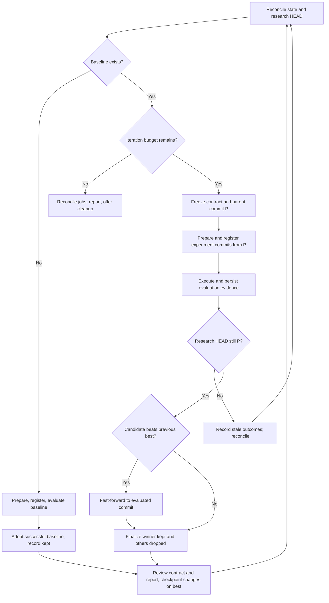

# Experiment Loop

Both modes follow this lifecycle; their references supply the concrete operations.

NEVER STOP the experiment loop until the MAX_ITERATIONS limit is reached or user explicitly interrupts it.

On errors, preserve state, recover within scope, and continue. If user input or a capability is needed, wait for it and resume; do not end the loop or bypass unresolved checks.

## Supplied baseline before contract confirmation

Before presenting the final contract, compare the user-provided baseline commit with the proposed contract baseline. If differences may affect results, or cannot be assessed, ask the user whether to reuse it. Otherwise, read BASELINE and prepare iteration 0 without rerunning it. Require the original `commit` and comparison `metrics`; collect other information when available, but run status, timestamps, and logs are optional.

Store the source as `BASELINE.commit` and `BASELINE.metrics`, with the comparison assessment and any user decision. After confirmation, save iteration 0 directly as `kept` with a summary. Keep the historical SHA in `commit`; set `parent_commit` to the prepared contract baseline SHA, including the GitHub contract commit. Any result-affecting preparation changes also need review. Do not move HEAD to the historical SHA.

For this imported record only, the effective kept commit is `parent_commit`; all other records use `commit`. Apply that record’s report checkpoints as described in step 5. Import once per session. Without supplied BASELINE, follow normal baseline execution below. These import rules override the execution requirements below and in both mode references.

## Shared state

Each batch is one numbered attempt. Baseline attempts use iteration 0 and unique IDs; positive iterations start at 1. Once any candidate is registered, the batch counts toward MAX_ITERATIONS even if failed, dropped, stale, or interrupted. After settling all records, use max(iteration) + 1, never latest_kept.iteration + 1.

Both stores use these experiment fields:

- Immutable identity: exp_id, iteration, contract_version, workspace (branch), start_time, commit, parent_commit, hypothesis.
- Results: end_time, metrics (JSON object), status, summary, log (evidence path or URL).

For executed runs, identity fields are required; text is non-empty, iteration is a non-negative integer, and contract_version references a stored contract. Reject unknown fields and non-finite JSON numbers. Create records as running; preserve identity on updates. Terminal records are immutable. Kept/dropped require end_time, metrics, and summary; failed requires end_time and summary. Successful completed runs stay running until a decision is recorded.

At most one record per iteration may have status kept. Register the whole batch before executing or finalizing any candidate; all share contract_version and parent_commit. Start a new batch only after all existing running records are settled. Positive iterations derive from the recorded research parent (defined below), with a distinct experiment commit. Baseline retries require the previous attempt to be terminal and no kept baseline.

Contract versions are immutable numeric dotted versions, starting at 1.0 and compared numerically. Append only newer versions; identical retries are idempotent. Load the latest contract only at each batch/baseline boundary, then freeze it. Recovery uses the versions referenced by existing records.

## 1. Reconcile and prepare

Read all records and research HEAD at startup and every batch boundary. Workspace offers recovery-state; GitHub applies the same checks to the research PR's marked experiment comments.

- Multiple running records matching HEAD: inconsistent; reconcile before continuing.
- Exactly one running record matches HEAD, and is a baseline with no kept record or derives from the recorded research parent in a later iteration: possible adoption before state write. Verify saved evaluation and ancestry; finalize kept when verified; otherwise preserve the record and resolve missing evidence.
- Otherwise, if a kept record exists, HEAD must equal the recorded research parent. Recover unrecorded report commits using step 5; reconcile other mismatches without rewriting history.
- Reconcile remaining running jobs: wait for or stop them, preserve successful evaluated runs as dropped with an interrupted-decision explanation, and record unsuccessful/unverifiable runs as failed. Retain observations and metrics. If termination/results are uncertain, preserve running state until resolved.
- Repeat after recovery. With no running records, import the confirmed supplied baseline if not yet recorded, or run baseline if none was supplied and none is kept; otherwise finish any pending contract/report updates (step 5), then start the next iteration or stop at MAX_ITERATIONS.

Prepare baseline code as needed, commit before execution, and register iteration 0 with a unique ID. Reuse HEAD if no preparation was needed; no empty commit is required. Evaluate with the same evidence rules as other experiments. Adopt a successful baseline before recording kept. Preserve failed attempts before retrying.

For normal batches, freeze the contract and research HEAD as parent_commit. Resolve incompatible evaluation-protocol changes before comparing with the kept model.

## 2. Form hypotheses

Think in terms of First Principles. You should consider the problem this model is trying to solve, and think the solution in First Principles, focusing on the rationale rather than superficial fixes. You can refactor the approach based on fundamental insights rather than incremental adjustments when required.

Review baseline assumptions and relevant design history initially; revisit them when new evidence warrants it.

- **Real objective:** Distinguish symptoms from causes and methods from goals. Challenge the baseline’s problem definition; point out a better problem when warranted. Pursue it within scope, confirming objective or contract changes first.
- **Design history:** Trace MODEL_DIR commits, key PRs when available, and architecture changes. Distinguish deliberate constraints from legacy workarounds; check whether their original reasons still apply. Cite evidence and flag unknowns.
- **Alternatives and risks:** Consider solutions from other fields and whether their assumptions transfer. Seek the strongest counterargument to your preferred solution and define evidence that would disprove it. Anticipate second- and third-order effects on other modules, users, complexity, and maintenance; choose diagnostics accordingly.

Propose an optimization direction based on observed symptoms and likely causes. You should carefully review logs, metric trends, feature diagnostics, and past outcomes. Explain each hypothesis as symptom → likely cause → proposed change. Favor focused, related changes so results can be attributed: such as data quality, model architecture, feature engineering, hyper-parameter settings, and training or evaluation procedures. Try useful variations of promising directions without repeating failed attempts.

Use [data analysis](data_analysis.md) when evidence is insufficient. After several batches without improvement, consult relevant and high-quality research papers, for instance, recent publications in the field with highly-cited or peer-reviewed results, and retain findings in the mode's output location. Dropped may reflect interruption or stale parent, not a bad hypothesis.

## 3. Execute

Prepare exactly NUM_WORKERS independent experiment branches per non-baseline batch from the same parent, each with exactly one experiment commit. Workspace mode switches its fixed worker worktrees onto new branches; GitHub mode creates remote commits and branches through its tools.

During implementation, check what matters to the experiment and retain the findings:

- **Downstream effects:** Test affected interfaces and predicted consequences. Separate observations from predictions.
- **Counterexamples:** Test boundary cases and evidence against the hypothesis. Reconsider the solution when contradicted; keep the adoption rule fixed.
- **Handoff cost:** Make affected code understandable to a capable newcomer: clear names, useful abstractions, explicit responsibilities and assumptions. Verify behavior and historical constraints before removing workarounds; keep unrelated cleanup separate.

Finish code changes before registration; later diagnostics must use the same commit.

Register all candidates before the execution-triggering operation. Set log to a durable evidence location; retain commands, branch/worktree, job/run IDs, attempt, and output links there. Never change an evaluated branch during execution or collection. Fixes use a new ID and commit in the next batch; baseline retries remain iteration 0.

Run training and evaluation using EXECUTION and REQUIREMENTS from the frozen contract. Require evidence of the actual evaluated commit, final outcome, and contract metrics. Submission success is not training success. Save successful evidence, end time, metrics, and analysis while status stays running; record execution failures as failed. Missing required metrics cannot support adoption.

## 4. Decide and adopt

Compare candidates against latest kept under the frozen contract. Check research HEAD against parent_commit for every batch, even without a winner. If changed, preserve failures, mark successes dropped with stale parent, and reconcile HEAD before continuing.

For a winner, fast-forward research HEAD to the exact evaluated commit, then record kept. Never squash, rebase, cherry-pick, or create a merge commit as a substitute. If updating HEAD fails or its outcome is uncertain, retain running state and reconcile. Finalize other successes as dropped with evidence and rationale.

Once all records are terminal, follow step 5, then repeat from reconciliation until the budget is reached or the user interrupts.

## 5. Checkpoint contract and report

After baseline adoption/import, each completed batch (even without a winner), and final reporting, check whether the contract or report needs updating. Only commit updates once a kept model exists, all experiments are terminal, and adoption is fully recorded.

1. **Update:** Confirm contract changes before saving a new immutable version. Refresh the [report](generate_report.md) and confirmed contract snapshot as needed. These files are generated from the authoritative state store.
2. **Commit:** If files changed, append one commit directly to RESEARCH_BRANCH. Include only reviewed report, contract, and non-executable report artifacts; exclude runtime data and scripts. Check the full diff cannot affect training, evaluation, dependencies, or job triggers. The commit must have the recorded research parent as its sole parent; guard the branch update against a changed HEAD. No changes means no commit.
3. **Record:** Save an immutable checkpoint in the mode's state store: `commit_hash`, `parent_commit`, `kept_exp_id`, `contract_version`, and `paths_json` (reviewed repository-relative paths). Finish this write before making another commit.
4. **Continue:** Use the new HEAD as the next batch's `parent_commit`. Keep historical experiment records and evaluated SHAs unchanged; comparisons still use the latest kept model's metrics. If the evaluation protocol changed, resolve metric comparability before continuing.

The **recorded research parent** is the latest kept model's effective commit, or its latest report checkpoint if one exists. Adopting a new winner resets it to that winner's evaluated commit. Report commits carry no evaluation metrics.

**If interrupted after committing:** Find the checkpoint by full SHA before retrying. If missing, verify the commit's sole parent, full diff, confirmed contract snapshot, and settled experiment records using the checks above, then save the missing checkpoint. If a check fails or records conflict, reconcile before continuing; never rewrite experiment records to accept an unexpected HEAD.

## Finally

On any exit, inspect HEAD and running records, wait for or stop jobs, and finalize using the recovery rules. Preserve running records matching HEAD for adoption recovery. Never finalize jobs whose completion/termination cannot be confirmed. Save evidence and generate the report before offering cleanup. If step 5’s commit conditions are unmet, save an untracked report draft or GitHub comment and defer the checkpoint.

List the exact session-owned worker worktrees and experiment branches eligible for cleanup, including whether branches are local or remote, and ask for user confirmation. Without confirmation, retain them. Explain that deleting the last branch referencing a dropped/failed commit can make its code unrecoverable; a recorded SHA alone is not an archive. Keep such branches unless the user accepts that loss or requests a durable archive first.

After confirmation, recheck ownership, job completion, uncommitted changes, and branch heads; delete only the approved unchanged targets using the selected mode. Exclude unresolved experiments. Preserve the primary workspace, RESEARCH_BRANCH, research PR, contract, records, logs, and report. Report what was removed, retained, or blocked and whether recovery is possible.
